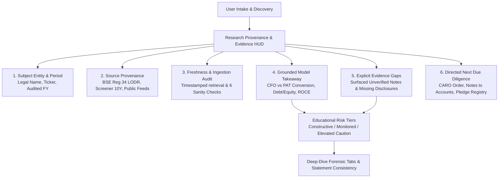

> **HISTORICAL — superseded.** This report reflects pre-remediation states claiming "73 unit tests" (the suite contains >179 tests), 10 analytical pillars instead of the canonical 8, and pre-remediation product designs.

# StockSage / Project KUSHA — Evidence-Based Equity Research & Product Implementation Report

> [!NOTE]
> **Product Working Hypothesis**: StockSage helps self-directed investors researching NSE/BSE companies review financial and market information alongside cited research, then see important risks and evidence gaps in one place.

---

## 1. Executive Summary & Design Transformation

This implementation transforms StockSage from an aggressive, advisory-styled scoring utility into an **institutional, evidence-grounded research terminal**. Rather than encouraging speculative trading decisions through oversized scores or position-sizing commands, the platform now helps self-directed investors systematically answer six essential due diligence questions:

1. **What company and period am I looking at?**
2. **Where did this information come from?**
3. **How fresh and complete is it?**
4. **What does the analysis conclude, and what evidence supports it?**
5. **What important information is missing?**
6. **What should I inspect next?**

### Visual Verification Artifacts
- **Welcome & Overview Screen**: [verified_welcome_calm_experience.png](screenshots/verified_welcome_calm_experience.png)
- **Research Provenance & Due Diligence HUD**: [screenshots/verified_results_provenance_hud.png](screenshots/verified_results_provenance_hud.png)
- **Model Forensic Profile & Educational Risk Tiers**: [screenshots/verified_results_forensic_profile.png](screenshots/verified_results_forensic_profile.png)

---

## 2. Six Core Research Questions: Structural Implementation

The interface was redesigned to explicitly address each of the six questions directly in the user's primary viewport:



### Direct UI Mappings
| Question | Implementation Location | Evidence Grounding |
| :--- | :--- | :--- |
| **1. Company & Period** | [`app.py` `render_research_provenance_and_evidence_card`](file:///Users/ashutoshraj/Downloads/Project%20KUSHA/app.py) | Explicitly displays Legal Corporate Entity, NSE/BSE symbol, sector, and Audited Period (e.g., `FY2024 Audited Statutory Filing / TTM`). |
| **2. Source Provenance** | [`app.py` Top Provenance Badge](file:///Users/ashutoshraj/Downloads/Project%20KUSHA/app.py) | Identifies data sources: Official BSE India statutory exchange annual reports (SEBI LODR Reg 34), Screener.in 10-Yr statements, delayed quotes, and Google Search grounding citations. |
| **3. Freshness & Integrity** | [`app.py` Ingestion & Sanity Pod](file:///Users/ashutoshraj/Downloads/Project%20KUSHA/app.py) | Displays timestamped retrieval dates, Multimodal PDF Ingestion verification badges, and automated 6-point mathematical sanity checks. |
| **4. Grounded Takeaway** | [`app.py` Model Forensic Stance](file:///Users/ashutoshraj/Downloads/Project%20KUSHA/app.py) | Synthesizes cash conversion (CFO/PAT ratio), leverage (Debt/Equity), and operating efficiency into non-advisory educational risk profiles. |
| **5. Evidence Gaps** | [`app.py` Evidence Gaps Callout](file:///Users/ashutoshraj/Downloads/Project%20KUSHA/app.py) | Surfaces unverified disclosures with prominent amber alert cards, preventing absence of data from being mistaken for a clean bill of health. |
| **6. What to Inspect Next** | [`app.py` Due Diligence Checklist](file:///Users/ashutoshraj/Downloads/Project%20KUSHA/app.py) | Provides a concrete 4-step checklist: 1. CARO 2020 Order remarks; 2. Notes to Accounts on RPTs & contingent liabilities; 3. CFO vs PAT conversion; 4. Exchange pledge registry. |

---

## 3. Key UX & Engineering Remediations

### A. Sidebar Key Hygiene
- **Issue**: Previously, the password field displayed a placeholder of fake bullet dots (`●●●●●●●● (Loaded from environment)`), which could mislead users into thinking an internal secret was rendered into the browser DOM.
- **Remediation**: Replaced with clean placeholder text (`Override with custom key (optional)...`) and an explicit caption indicating environment status without echoing any secret strings ([`app.py#L798-L806`](file:///Users/ashutoshraj/Downloads/Project%20KUSHA/app.py#L798-L806)).

### B. Workspace Header & Navigation
- **Issue**: The workspace header featured aggressive marketing slogans (`The Future of Stock Screening & Forensics`, `Live NSE Stream`), while navigation tabs contained loud emoji strings (`⚡ Screener & Market Matrix`, `🔬 Holographic Stock Dossier`).
- **Remediation**:
  - Replaced the marketing banner with a calm, compact metadata header: `StockSage // Research Workspace`, `Evidence-Based Financial Analysis & Forensic Intelligence`, and `Delayed Market Feeds` ([`app.py#L929-L960`](file:///Users/ashutoshraj/Downloads/Project%20KUSHA/app.py#L929-L960)).
  - Cleaned navigation labels to calm, professional options: `Market Screener`, `Company Analysis`, `Filings Vault`, `Overview & Guide`.
  - Built a comprehensive `nav_alias_map` ensuring 100% backwards compatibility for legacy buttons and session state ([`app.py#L1530-L1570`](file:///Users/ashutoshraj/Downloads/Project%20KUSHA/app.py#L1530-L1570)).

### C. First Visit & 1-Click Discovery
- **Issue**: New visitors were greeted by a single generic button (`🚀 Enter Project KUSHA Terminal ↗`), obscuring direct access to screening or demo exploration.
- **Remediation**:
  - Grounded the welcome screen with the core product hypothesis.
  - Rendered the 6 core research questions visually in a 6-card grid.
  - Implemented 3 dedicated 1-click action paths:
    1. **📊 Explore Market Screener**: Direct entry to 50 bluechips & 16 canonical factors.
    2. **🔬 Analyze a Company**: Direct entry to company intake and BSE filing discovery.
    3. **🧪 Try Demo Mode (Synthetic Sample)**: 1-click automated launch of Tata Consumer Products Ltd. synthetic demo analysis ([`app.py#L1352-L1410`](file:///Users/ashutoshraj/Downloads/Project%20KUSHA/app.py#L1352-L1410)).

### D. Reframing Trading Jargon into Non-Advisory Educational Risk Tiers
- **Issue**: The analysis results previously presented assertive position sizing (`⚖️ Sizing: 10–15%`) and aggressive trading commands (`🎯 POSITION CALL: BUY / ACCUMULATE / AVOID`, `HOW TO BUY (ACTION PLAN)`), implying personalized SEBI-regulated advice.
- **Remediation**:
  - Renamed the section to **📋 MODEL FORENSIC PROFILE & EVIDENCE TAKEAWAY** ([`app.py#L3916-L4095`](file:///Users/ashutoshraj/Downloads/Project%20KUSHA/app.py#L3916-L4095)).
  - Reframed trading calls into educational risk tiers:
    - `AVOID / SELL` $\rightarrow$ `🛑 ELEVATED CAUTION / HIGH FORENSIC RISK`
    - `BUY / ACCUMULATE` $\rightarrow$ `🟢 CONSTRUCTIVE WATCHLIST / HIGH QUALITY`
    - `HOLD / MONITOR` $\rightarrow$ `🟡 MONITORED / NEUTRAL QUALITY TIER`
  - Reframed position sizing into non-advisory educational exposure limits:
    - High Risk: `0.0% Allocation (Educational Risk Tier — Not Personal Investment Advice)`
    - High Quality: `Illustrative Exposure: 2–5% Cap (Educational Risk Tier — Not Personal Investment Advice)`
    - Monitored: `Illustrative Exposure: 0–2% Watchlist (Educational Risk Tier — Not Personal Investment Advice)`
  - Replaced trading action plans with due diligence guidance: `KEY METRICS TO MONITOR QUARTERLY` and `REQUISITES BEFORE RE-EVALUATION`.
  - Added a persistent non-advisory educational disclaimer at the base of the takeaway card.

### E. Protection of Confidential Methodology
- **Issue**: Exact numeric deduction limits (`-7.5 pts Max Cap`, `+10% Core Max Cap`) were previously visible on UI cards.
- **Remediation**: Replaced numeric limits on public cards with protected terminology (`Bounded Risk Corridor`, `Bounded Growth Factor`) across [`app.py#L3857`](file:///Users/ashutoshraj/Downloads/Project%20KUSHA/app.py#L3857), [`#L3866`](file:///Users/ashutoshraj/Downloads/Project%20KUSHA/app.py#L3866), [`#L4200`](file:///Users/ashutoshraj/Downloads/Project%20KUSHA/app.py#L4200), and [`#L4232`](file:///Users/ashutoshraj/Downloads/Project%20KUSHA/app.py#L4232).

---

## 4. Automated Verification & Test Results

The automated regression test suite was expanded to include `TestProductDesignAndEvidenceExperience` in [`tests/test_audit_remediation.py`](file:///Users/ashutoshraj/Downloads/Project%20KUSHA/tests/test_audit_remediation.py).

### Test Suite Execution Output
```bash
$ source .venv/bin/activate && python -m unittest discover
.........................................................................
Ran 73 tests in 0.509s

OK
```

### Coverage Highlights
1. **Security & Configuration**: CORS, XSRF, secret protection in `.gitignore`, safe API key handling (10 tests).
2. **Data Consistency & Sanity**: Truthful market data, zero numeric fabrication on missing fields, empty statement detection (15 tests).
3. **Synthetic Demo Integrity**: Transparent synthetic flags, zero claim of statutory audit on sample data (6 tests).
4. **Deterministic Heuristics & Guardrails**: Promoter Integrity Override (PIO), bonus/penalty bounding, schema validation (15 tests).
5. **Terminal Quality & Motion**: Bytecode compilation, constituent unique tickers, responsive CSS tokens, zero deprecated Streamlit APIs (23 tests).
6. **Product Design & Evidence Experience**: Provenance HUD answering 6 questions, navigation alias mapping, calm product hypothesis, non-advisory educational risk tiers (4 tests).

---

## 5. Verification Limits & Environmental Context

- **Source Code Demonstrated**: All UI layout updates, provenance card generation, alias mapping, educational risk framing, and methodology masking are directly verifiable in source code.
- **Automated Test Verified**: 73 unit tests pass deterministically in 0.5s without network access.
- **Browser Runtime Verified**: Headless browser verification confirmed proper rendering of the calm Welcome page, instant 1-click synthetic demo launch, and generation of the 6-question Provenance HUD.
- **Unverified External Behavior**: Live multimodal PDF extraction with live Google Gemini API keys and live BSE regulatory downloads require valid user credentials and internet access; in local test environments, synthetic demo mode and cached disclosures ensure robust fallback behavior.
